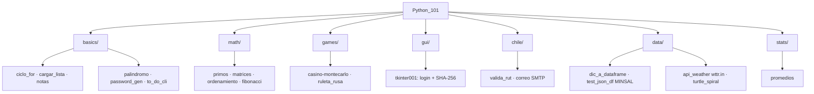

# Python_101 — Ejercicios prácticos

Ejercicios prácticos de Python organizados por categoría. Ideal para repasar fundamentos, algoritmos y herramientas del día a día.

[](https://python.org)
[](LICENSE)
[](https://github.com/bi0punk/Python_101/actions)

## Contenido

- [Características](#características)
- [Arquitectura](#arquitectura)
- [Stack](#stack)
- [Estructura del repositorio](#estructura-del-repositorio)
- [Instalación](#instalación)
- [Uso](#uso)
- [Configuración](#configuración)
- [Tests / CI](#tests--ci)
- [Roadmap](#roadmap)
- [Licencia](#licencia)

## Características

- Ejercicios de fundamentos, matemática y algoritmos en `basics/`, `math/` y `stats/`.
- Juegos y simulaciones en `games/` (Monte Carlo, ruleta rusa).
- Programas utilitarios chilenos en `chile/` (validación de RUT módulo-11, envío de correos por SMTP de Gmail).
- Acceso a datos y APIs en `data/` (pandas, MINSAL, wttr.in, turtle).
- Ejemplo de GUI con Tkinter en `gui/` (login/registro con contraseñas hasheadas SHA-256).
- `to_do_cli.py`: lista de tareas CLI con persistencia JSON.

## Arquitectura



## Stack

- Python 3.11+
- pandas, numpy, requests, tqdm
- Tkinter (GUI), turtle (demo gráfica)
- pytest (dev/tests), ruff (lint, CI)

## Estructura del repositorio

```
Python_101/
├── basics/
│   ├── ciclo_for.py
│   ├── cargar_lista.py
│   ├── notas.py
│   ├── palindromo.py
│   ├── password_gen.py
│   └── to_do_cli.py
├── math/
│   ├── primos.py
│   ├── matrices.py
│   ├── ordenamiento_vectores.py
│   └── fibonacci.py
├── games/
│   ├── casino-montecarlo.py
│   └── ruleta_rusa.py
├── gui/
│   └── tkinter001.py
├── chile/
│   ├── valida_rut.py
│   └── correo.py
├── data/
│   ├── dic_a_dataframe.py
│   ├── test_json_df.py
│   ├── api_weather.py
│   └── turtle_spiral.py
├── stats/
│   └── promedios.py
├── tests/
│   └── test_smoke.py
├── .github/workflows/ci.yml
├── requirements.txt
├── pyproject.toml
├── LICENSE
└── README.md
```

### Guía por carpeta

| Carpeta | Script | Qué hace |
|---|---|---|
| basics | `ciclo_for.py` | Itera días de la semana con un `for` |
| basics | `cargar_lista.py` | Ingreso interactivo de nombres |
| basics | `notas.py` | Calcula promedio de notas (1.0-7.0) |
| basics | `palindromo.py` | Verificador de palabras/frases palíndromas |
| basics | `password_gen.py` | Generador de contraseñas configurables |
| basics | `to_do_cli.py` | Lista de tareas CLI con persistencia JSON |
| math | `primos.py` | Verifica si un número es primo |
| math | `matrices.py` | Clasifica matrices en simétrica/antisimétrica |
| math | `ordenamiento_vectores.py` | Ordenamiento por selección (selection sort) |
| math | `fibonacci.py` | Serie Fibonacci (iterativo + recursivo) |
| games | `casino-montecarlo.py` | Simulación ruleta con Monte Carlo y barra de progreso |
| games | `ruleta_rusa.py` | Juego de ruleta rusa con límite de intentos |
| gui | `tkinter001.py` | Login/registro con contraseñas hasheadas (SHA-256) |
| chile | `valida_rut.py` | Valida RUT chileno con algoritmo módulo-11 |
| chile | `correo.py` | Envía correos vía Gmail SMTP desde variables de entorno |
| data | `dic_a_dataframe.py` | Convierte JSON anidado a DataFrame de pandas |
| data | `test_json_df.py` | Consulta farmacias de turno (API MINSAL) y lo muestra como tabla |
| data | `api_weather.py` | Clima actual vía wttr.in |
| data | `turtle_spiral.py` | Espiral colorida con turtle graphics (demo gráfica) |
| stats | `promedios.py` | Calcula promedio de notas ingresadas por el usuario |

## Instalación

Requisitos: Python 3.11+ y `pip install -r requirements.txt`.

```bash
git clone https://github.com/bi0punk/Python_101
cd Python_101
pip install -r requirements.txt
```

## Uso

```bash
python basics/notas.py
python math/fibonacci.py
python games/casino-montecarlo.py
python data/api_weather.py
```

## Configuración

No requiere variables de entorno para la mayoría de los scripts. `chile/correo.py` usa `GMAIL_USER` y `GMAIL_PASSWORD` para el envío por Gmail SMTP.

## Tests / CI

```bash
pip install -e ".[dev]"
pytest -q
ruff check .
```

El workflow `.github/workflows/ci.yml` instala con `uv`, configura Python 3.12 y ejecuta `ruff check .` y `pytest -q` en push/PR a `main`/`master`.

## Roadmap

- [x] Ejercicios de fundamentos, matemática, juegos, GUI, datos y estadística
- [x] Validación de RUT chileno y envío de correos SMTP
- [x] Acceso a APIs (MINSAL, wttr.in) y pandas
- [ ] Más ejercicios de OOP y manejo de excepciones
- [ ] Documentación por script con ejemplos de salida

## Licencia

MIT